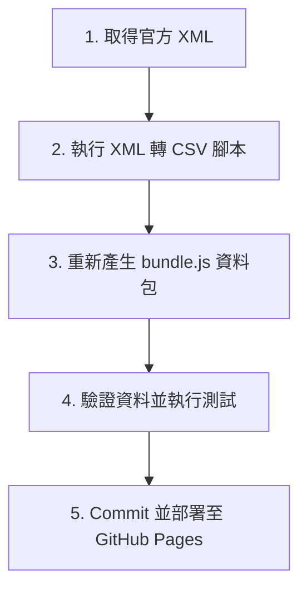

# 機捷快選 - 班表與資料更新教學 (DATA_UPDATE.md)

本文件詳細說明當桃園捷運（Taoyuan Airport MRT）發布新版時刻表、調整車次，或未來新增站點（例如 **A23 中壢車站**）時的資料更新步驟。

---

## 標準更新流程 (4 步驟)



---

### 第一步：取得官方 `StationTimeTable.xml`

1. 從政府資料開放平台 (TDX / OpenData) 或桃園捷運官方下載最新的 `StationTimeTable.xml` 站別時刻表檔案。
2. 將 XML 檔案放到專案目錄中（例如暫存為 `StationTimeTable.xml` 或 `raw/StationTimeTable.xml`）。

---

### 第二步：轉換 XML 為 CSV 格式

開啟命令列（Terminal / PowerShell），執行轉換腳本 [tools/convert_tymetro_xml.py](tools/convert_tymetro_xml.py)：

```bash
python tools/convert_tymetro_xml.py StationTimeTable.xml \
  --stations data/stations.csv \
  --out data/timetable.csv \
  --version data/version.json \
  --data-version "StationTimeTable.xml-YYYY-MM-DD"
```

> **提示**：轉換器會自動將站點時刻資料重建為跨站列車行程 (`train_id`)，並處理末班抵達時間。若有全新站點 (如 A23)，轉換腳本已包含 `A23` 的排序設定 (`STATION_ORDER`)。

---

### 第三步：重新產生 `data/bundle.js` 靜態資料包

為了確保網頁在離線環境、PWA 快取以及直接雙擊開啟 (`file://`) 時皆能運作，請執行打包腳本 [tools/build_bundle.py](tools/build_bundle.py)：

```bash
python tools/build_bundle.py
```

執行後會自動更新 [data/bundle.js](data/bundle.js)。

---

### 第四步：執行資料驗證與單元測試

上線前請務必執行驗證與測試指令：

1. **驗證 CSV 完整性**：
   ```bash
   python tools/validate_data.py data/stations.csv data/timetable.csv
   ```
   確認輸出中 `Errors: 0` 且包含預期的車站數與車次數。

2. **執行演算法測試**：
   ```bash
   python tools/test_router.py
   ```
   確認顯示 `[SUCCESS] All Python router & data integration tests passed successfully!`。

---

## 擴充新站點注意事項 (如新增 A23 中壢車站)

如果未來開通 A23 中壢車站，除上述更新步驟外，請檢查下列檔案：
1. **[data/stations.csv](data/stations.csv)**：確認 `A23,中壢車站,23,true` 欄位正確。
2. **[src/router.js](src/router.js)**：
   - 檢查 `normalizeDirection()` 中的方向關鍵字是否已包含 `往中壢`。
   - 檢查 `calculateFare()` 中的票價階梯上限（目前設為 NT$ 160）。
